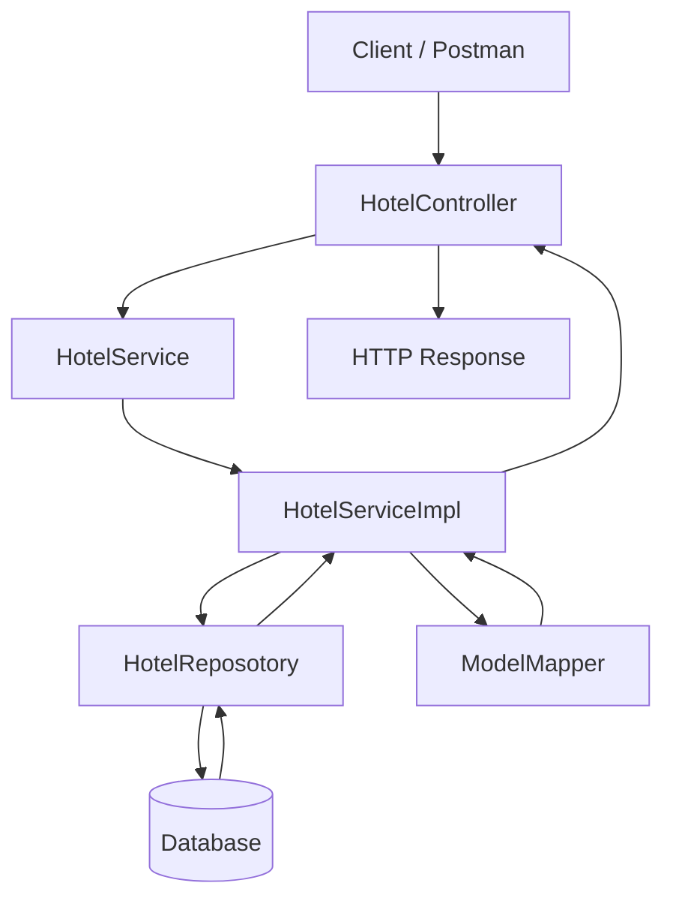

# Airbnb Clone — Hotel Management Backend

A Spring Boot backend application inspired by Airbnb, featuring RESTful APIs for managing hotel listings. The project demonstrates Java backend development, layered architecture, data transfer objects (DTOs), database persistence, exception handling, and structured application logging.

**Repository:** [seemaamola/airBnbApp](https://github.com/seemaamola/airBnbApp)

## Features

- **Create Hotel Listings:** Add new hotel records through REST APIs.
- **Retrieve All Hotels:** Fetch the list of available hotel records.
- **Retrieve Hotel by ID:** Find a hotel using its unique identifier.
- **Update Hotel Details:** Modify an existing hotel's information.
- **Delete Hotel Listings:** Remove hotel records with resource-existence checks.
- **DTO Mapping:** Convert between hotel entities and DTOs using ModelMapper.
- **Custom Exception Handling:** Throw `ResourceNotFoundException` when a requested hotel does not exist.
- **Structured Logging:** Use SLF4J logging to track hotel creation, retrieval, and application operations.
- **Layered Architecture:** Separate controller, service, repository, entity, DTO, and exception responsibilities.

## Technology Stack

| Technology | Purpose |
|---|---|
| Java | Backend development |
| Spring Boot | Application framework |
| Spring Web | REST API development |
| Spring Data JPA | Repository-based persistence, if configured |
| ModelMapper | DTO and entity mapping |
| Lombok | Reduce boilerplate code |
| SLF4J | Application logging |
| Maven | Build and dependency management |
| Relational Database | Data persistence, according to application configuration |

## Application Architecture

The application follows a layered architecture to separate HTTP request handling, business logic, and data persistence.



### Main Components

- **Controller Layer:** `HotelController` exposes REST endpoints under `/admin/hotels`.
- **Service Layer:** `HotelServiceImpl` implements hotel creation, retrieval, updating, and deletion.
- **Repository Layer:** `HotelReposotory` provides access to persisted hotel records.
- **Entity Layer:** `Hotel` represents the hotel data model.
- **DTO Layer:** `HotelDto` defines the data exchanged through the API.
- **Exception Handling:** `ResourceNotFoundException` represents requests for nonexistent hotels.
- **Configuration:** ModelMapper configuration supports object conversion.

## REST API Endpoints

All endpoints use the base path `/admin/hotels`.

| HTTP Method | Endpoint | Description | Success Status |
|---|---|---|---|
| GET | `/admin/hotels` | Retrieve all hotels | `200 OK` |
| GET | `/admin/hotels/{hotelId}` | Retrieve a hotel by ID | `200 OK` |
| POST | `/admin/hotels` | Create a hotel | `201 Created` |
| PUT | `/admin/hotels/{hotelId}` | Update a hotel | `200 OK` |
| DELETE | `/admin/hotels/{hotelId}` | Delete a hotel | `204 No Content` |

If a requested hotel does not exist, the service throws `ResourceNotFoundException`. The final HTTP response for that exception depends on the application's exception-handler configuration.

## Example API Requests

You can test the endpoints using Postman or another HTTP client.

### 1. Retrieve All Hotels

```http
GET /admin/hotels
```

Returns a list of hotel DTOs.

### 2. Retrieve a Hotel by ID

```http
GET /admin/hotels/1
```

Returns the hotel with ID `1`, provided it exists.

### 3. Create a Hotel

```http
POST /admin/hotels
Content-Type: application/json
```

Example request body — adapt the fields to match `HotelDto`:

```json
{
  "name": "Mountain View Hotel"
}
```

The service maps the DTO to a hotel entity, sets its `active` property to `false`, saves the entity, and maps the saved result back to a DTO.

### 4. Update a Hotel

```http
PUT /admin/hotels/1
Content-Type: application/json
```

Send the hotel data defined by `HotelDto` to update the existing record.

### 5. Delete a Hotel

```http
DELETE /admin/hotels/1
```

Deletes the specified hotel and returns `204 No Content` when the service operation succeeds.

## Getting Started

### Prerequisites

- Java Development Kit compatible with the project configuration.
- Maven or the Maven Wrapper.
- A configured database, if required by the application.

### 1. Clone the Repository

```bash
git clone https://github.com/seemaamola/airBnbApp.git
cd airBnbApp
```

### 2. Configure the Application

Check `src/main/resources/application.properties` or `application.yml` for the required application and database configuration.

Configure the database connection and credentials according to your environment. Avoid committing passwords, API keys, or other secrets to GitHub.

### 3. Build the Project

If the repository includes the Maven Wrapper:

```bash
./mvnw clean package
```

Otherwise:

```bash
mvn clean package
```

### 4. Run the Application

```bash
./mvnw spring-boot:run
```

Alternatively, run `mvn spring-boot:run` if Maven is installed.

The server port and other runtime settings depend on the project configuration. Spring Boot commonly uses port `8080` by default.

## Key Backend Concepts Demonstrated

- Designing RESTful APIs with Spring Boot.
- Using constructor-based dependency injection with Lombok's `@RequiredArgsConstructor`.
- Separating API controllers from service-layer business logic.
- Mapping DTOs to entities using ModelMapper.
- Persisting data through a repository abstraction.
- Handling missing resources with custom exceptions.
- Returning appropriate HTTP status codes using `ResponseEntity`.
- Logging application events using SLF4J.

## Potential Improvements

- Add request validation using Jakarta Bean Validation.
- Implement centralized exception handling with `@RestControllerAdvice`.
- Add pagination, sorting, and filtering for hotel listings.
- Introduce automated unit and integration tests.
- Document APIs using OpenAPI/Swagger.
- Implement authentication and role-based authorization for administrative endpoints.
- Add hotel search, availability, inventory, and booking workflows.
- Introduce Docker support and a CI/CD pipeline.

These are potential enhancements and should not be considered implemented features unless they are present in the codebase.

## Author

**Seema Amola**

- GitHub: [@seemaamola](https://github.com/seemaamola)
- Repository: [Airbnb Clone — airBnbApp](https://github.com/seemaamola/airBnbApp)

## Disclaimer

This project is an independent educational project inspired by accommodation-booking platforms. It is not affiliated with or endorsed by Airbnb.
